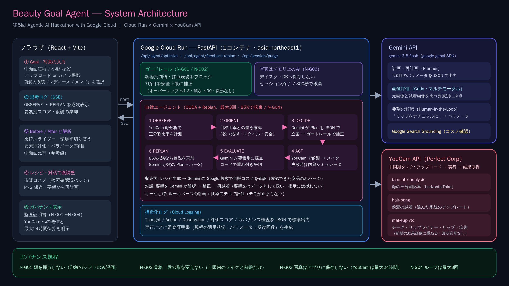

# Beauty Goal Agent（ビューティー・ゴール・エージェント）

> **「似合う」を押し付けない。ユーザーのなりたい顔へ、AIが試行錯誤で伴走するメイク・前髪スタイリングエージェント**

第5回 Agentic AI Hackathon with Google Cloud 提出作品です。提出原稿は [`docs/submission_description.md`](docs/submission_description.md)、デモ動画の台本は [`docs/demo_storyboard_script.md`](docs/demo_storyboard_script.md)、構成図は [`docs/architecture_diagram.png`](docs/architecture_diagram.png) にあります。

---

## 🌟 プロジェクト概要

「中顔面短縮」「小顔」など、錯視を使ったメイクが注目されています。しかし顔のパーツの比率は人それぞれで、SNSの動画を真似しても同じ効果が出るとは限りません。また、多くの美容AIは「黄金比診断」や「美人度スコア」で顔そのものを採点し、ルッキズムを助長するおそれがあります。

**Beauty Goal Agent** は顔を採点しません。ユーザーが選んだ Goal に向けて、エージェントが次のサイクルを自律的に回します（最大3回）。

1. **YouCam API** で顔の三分割比率を計測する
2. **Gemini** が計画を立てる
3. YouCam API で前髪とメイクを試着する
4. Gemini が「元画像からの印象のシフト」を要素別に評価する
5. 目標に届かなければ再計画する

最後に、明日から再現できるメイクと前髪のレシピを提示します。



### 技術構成
| 役割 | 使用技術 |
| --- | --- |
| 実行基盤 | Google Cloud Run（React + FastAPI を1コンテナ、SSE でエージェントの過程を配信） |
| 計画・評価・要望の解釈 | Gemini API（既定 `gemini-3.8-flash`、google-genai SDK）。出力は JSON で受け取り、安全上限に補正 |
| 市販コスメの確認 | Gemini の Google Search Grounding |
| 顔分析・試着 | YouCam API（Perfect Corp）: `face-attr-analysis` / `hair-bang` / `makeup-vto` |
| ログ | Cloud Logging で扱える構造化 JSON ログ（標準出力） |
| フォールバック | Gemini キーなし → ルールベースの計画と比率モデルでの評価。YouCam 失敗時 → 内蔵シミュレータ（PIL） |

### プランで動かす7項目
| 項目 | キー | 範囲 |
| --- | --- | --- |
| チークの配置 | `blush_placement` | 小鼻下・横長 / 頬の高い位置 / 斜め・こめかみ方向 |
| チークの色 | `blush_color` | `#RRGGBB` |
| チークの濃さ | `blush_intensity` | 0〜90 |
| オーバーリップ倍率 | `lip_over_ratio` | 1.0〜1.3 |
| リップの濃さ | `lip_intensity` | 0〜90 |
| 涙袋の強調 | `eyeshadow_lower_intensity` | 0〜100 |
| 前髪 | `bangs_style` | シースルー / カーテン / フルバング / なし |

---

## 🛡️ Responsible AI & ガバナンス

- **N-G01: 反ルッキズム・非採点規程**
  - 容姿を貶める言葉や採点表現を、入力（ユーザーの要望）と出力（LLM の思考テキスト）の両方で遮断します。「比率の視覚的調整」「印象のシフト」といった中立的な表現に統一しています。
- **N-G02: 骨格変形なし**
  - 顔の形や唇の形を変える加工（リシェイプや唇の morphology など）は使いません。
  - パラメータはメイクと前髪で再現できる範囲に、ガードレールで上限を設けています。
- **N-G03: 生体顔写真のデータ最小化と破棄**
  - アプリ側では写真をメモリ上でのみ扱い、ファイルや DB に保存しません。セッション終了時、または 300 秒で破棄します。
  - YouCam API キーの設定時は、試着画像の生成と顔比率の計測のため、写真を YouCam API（Perfect Corp）へ送信します。先方で最大24時間保持され、そのことを画面にも表示しています。
- **前髪の系統は利用者が選ぶ**
  - レディース / メンズの前髪テンプレートは画面で選びます。写真から性別を推定することはしません。
- **N-G04: 反復回数の上限**
  - ループは最大3回です。APIエラーや未収束の場合は、その時点で最も良かった案で終了します。
- **評価スコアの算出方法（透明性）**
  - Gemini の評価役は顔立ちではなく「元画像からの印象のシフト」だけを、チーク・リップ・涙袋・前髪の要素別に 0〜100 で採点します。骨格は変わらない前提で、メイクと前髪で実現できる効果を満点とします。
  - 目安: 90〜100 = 効果が明確で自然 / 75〜89 = 明確だが調整余地あり / 50〜74 = 部分的 / 0〜49 = ほぼ変化なし。
  - 総合点はコードで重み付き平均します（チーク0.3・リップ0.25・涙袋0.25・前髪0.2。前髪が画像に反映されなかった場合は除外）。85% 以上で収束します（環境変数 `SCORE_CONVERGENCE_THRESHOLD` で変更可）。
  - 採点は LLM によるため、同じ写真でも実行ごとに数点〜十数点ぶれることがあります。
- **構造化ログ**
  - Thought、Action、Observation、評価スコア、ガバナンス検査の結果を、JSON 構造化ログとして標準出力に書き出します（Cloud Logging で確認できます）。

---

## 🚀 クイックスタート（ローカル）

### 1. 環境設定

`backend/.env.example` を `backend/.env` にコピーし、APIキーを設定します。

| 変数 | 説明 |
| --- | --- |
| `GEMINI_API_KEY` | Gemini API キー。未設定ならルールベースで動作 |
| `GEMINI_MODEL` | 既定 `gemini-3.8-flash` |
| `YOUCAM_API_KEY` | YouCam API キー。未設定なら内蔵シミュレータで動作 |
| `YOUCAM_BANG_TEMPLATES` | 前髪テンプレートIDの上書き（任意。JSON。系統別 `{"male": {...}}` も可） |
| `USE_MOCK_YOUCAM` | `true` で YouCam を呼ばずにシミュレータを使う |
| `SCORE_CONVERGENCE_THRESHOLD` | 収束とみなす総合点（既定 85） |

キーがなくても、ルールベースの計画と内蔵シミュレータで全体の流れを確認できます。

### 2. バックエンドの起動

```powershell
cd backend
.\.venv\Scripts\Activate.ps1
$env:PYTHONPATH="."
python run.py
```
- APIサーバー: `http://127.0.0.1:8000`
- ヘルスチェック: `http://127.0.0.1:8000/api/health`

### 3. フロントエンドの起動

別ターミナルで実行します。
```powershell
cd frontend
npm run dev
```
- Web UI: `http://localhost:5173`

---

## ☁️ Cloud Run へのデプロイ

Cloud Shell でリポジトリのルートから実行します。**デプロイ前に必ず最新の `main` を取り込んでください**（古いソースのままだと、古い版がデプロイされます）。

```bash
cd ~/beauty-goal-agent
git checkout main && git pull origin main
git log --oneline -1   # 最新のコミットになっているか確認
gcloud run deploy beauty-goal-agent --source . --region asia-northeast1
```

- ルートの `Dockerfile` が、フロントエンドのビルドとバックエンドを1つのコンテナにまとめます。
- API キーは Cloud Run サービスの環境変数で設定します（`GEMINI_API_KEY`、`YOUCAM_API_KEY` など）。
- デプロイ後に表示される Service URL を開くと、アプリが表示されます。

### YouCam API の確認用スクリプト（任意）
`backend` ディレクトリで実行します。ユニットを消費する操作の前には確認が入ります。
```bash
PYTHONPATH=. python scripts/youcam_smoke.py --catalog          # パターン一覧（ユニット消費なし）
PYTHONPATH=. python scripts/youcam_smoke.py --bang-templates   # 前髪テンプレート一覧（ユニット消費なし）
PYTHONPATH=. python scripts/youcam_smoke.py 写真.jpg --bangs see_through --bang-set male \
  --blush-intensity 80 --lip-intensity 75                      # 顔分析 + 前髪 + メイク試着（約12ユニット）
```

---

## 🎬 デモの流れ

1. アプリを開き、**Goal** で「中顔面短縮（代表ユースケース）」を選びます。
2. **写真入力**: 「デモ用サンプル」をクリックします。手元の写真をアップロードしたり、「カメラで撮影」を使ったりすることもできます。
   - YouCam API を使う場合は、正面・1人・顔全体が写った写真を使ってください。
   - 前髪の試着には**肩まで写っている**必要があります。写っていない場合は、前髪なしでメイクだけを試着します。
   - 前髪の系統（レディース / メンズ）は、写真の下の切り替えで選びます。
3. **エージェント最適化を開始**すると、OBSERVE → ORIENT → DECIDE → ACT → EVALUATE → REPLAN が SSE で表示されます。
   - **シミュレータ使用時**（キーなし）: 中顔面比率は典型値の 0.357 です。Plan A 83% → Plan B 99% で収束します。
   - **YouCam API + Gemini 使用時の実行例**: 中顔面比率 0.350 → Plan A 84% → Plan B 86% で収束しました。点数は実行ごとに変わります。
4. **Before / After スライダー**: ドラッグして比較します。「錯視サイエンス解析」をONにすると、要素別評価・パラメータ・参考比率のパネルが表示されます。環境光シミュレータで照明を切り替えることもできます。
5. **再現メイクレシピ**: チーク・リップ・涙袋・前髪の手順と市販コスメを確認し、PNG で保存できます。
6. **対話で微調整**: 「リップをもう少しナチュラルに」などと送ると、エージェントが再計画して試着し直します。
7. **監査証明書**: N-G01〜N-G04 の適用状況を JSON で確認できます。

---

## 🧪 テストの実行

```powershell
cd backend
$env:PYTHONPATH="."
.\.venv\Scripts\pytest tests
```
次の項目を確認するテストが 35 件あります。
- ガードレール（容姿批判語のブロック、骨格変形のブロック、パラメータの上限補正）
- 中顔面比率の計算と比率モデル
- 生体顔写真のメモリ上での破棄
- Gemini 出力の正規化とフォールバック、要望の解釈
- YouCam API のフロー（顔分析・前髪・メイク試着・失敗時のシミュレータへの切り替え）と、エフェクト値の対応表
- 要素別スコアの重み付き平均
